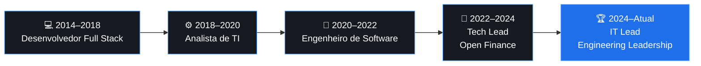

 <div align="center">


<br/>

<p>
  <a href="https://www.linkedin.com/in/sidneyfilho/">
    
  </a>
</p>

### Engenharia, arquitetura e liderança. Construindo soluções que geram valor.

</div>

---

## 👨‍💻 Sobre mim

Sou **IT Lead no Banco BV**, com experiência em engenharia de software, arquitetura de sistemas e liderança de equipes de tecnologia.

Minha trajetória começou no desenvolvimento Full Stack, passando por diferentes linguagens, bancos de dados, infraestrutura e computação em nuvem. Essa experiência me proporcionou uma visão ampla do ciclo de vida de software, desde o entendimento do negócio e desenho da solução até desenvolvimento, implantação, operação e evolução dos sistemas.

Atualmente, meu foco está na liderança técnica de equipes de engenharia, definição de soluções escaláveis, direcionamento arquitetural, desenvolvimento de pessoas e planejamento estratégico de entregas.

Atuo no ecossistema de **Open Finance**, trabalhando com soluções que exigem integração entre sistemas, segurança da informação, qualidade de software e aderência regulatória.

```java
public class SidneyCruz {

    String role = "IT Lead";
    String company = "Banco BV";
    String domain = "Open Finance";

    String[] focus = {
        "Engineering Leadership",
        "Software Architecture",
        "Distributed Systems",
        "API Design",
        "Cloud & DevOps",
        "People Development"
    };

    String mindset = "Think big. Build smart. Deliver value.";
}
```

---

## 🧭 Minha jornada



---

## 🚀 Expertise & Tech Stack

<div align="center">

### Backend Engineering


<br/>


### Frontend Engineering


### Databases


### Cloud & DevOps


</div>

### 🏗️ Architecture & Engineering Practices

- Microservices Architecture
- Hexagonal Architecture
- Event-Driven Architecture
- Distributed Systems
- RESTful APIs & HATEOAS
- API Gateway & Service Discovery
- CI/CD & Automated Deployments
- Observability & Monitoring
- Software Quality & Automated Testing
- Information Security & Secure Development
- Agile Methodologies & Engineering Leadership

---

## 💼 Professional Experience

<details>
<summary><b>🏦 Banco BV — IT Lead | Open Finance</b></summary>

**Dezembro/2024 – Atual**

Atuação na liderança de equipes de engenharia, direcionamento técnico e planejamento estratégico das entregas.

- Liderança e desenvolvimento de profissionais de engenharia.
- Direcionamento de soluções alinhadas à arquitetura corporativa e segurança.
- Planejamento de entregas em parceria com as áreas de negócio.
- Definição de soluções modernas, escaláveis e resilientes.
- Gestão de pessoas, feedbacks e desenvolvimento técnico.
- Gestão de orçamento e acompanhamento de entregas.
- Atuação em sistemas de missão crítica e projetos regulatórios.

</details>

<details>
<summary><b>🏦 Banco BV — Tech Lead</b></summary>

**Setembro/2022 – Março/2025**

- Liderança técnica de times de engenharia.
- Definição de soluções arquiteturais e contratos de APIs.
- Desenvolvimento evolutivo de sistemas e microsserviços.
- Atuação em incidentes e ambientes produtivos.
- Planejamento e acompanhamento de mudanças em produção.
- Garantia de aderência às especificações do Open Finance Brasil.
- Aplicação de boas práticas de desenvolvimento, segurança e qualidade.

</details>

<details>
<summary><b>💻 Certsys — Desenvolvedor de Software Sênior</b></summary>

**Dezembro/2021 – Setembro/2022**

Desenvolvimento de aplicações utilizando Java, JavaScript, Spring Boot e microsserviços.

Principais tecnologias: Google Cloud, OpenFeign, JUnit, JDBI, Angular, TypeScript, MySQL e arquitetura hexagonal.

</details>

<details>
<summary><b>☁️ iBlue Consulting — Desenvolvedor de Software Sênior</b></summary>

**Julho/2021 – Novembro/2021**

Desenvolvimento de soluções com foco em computação em nuvem AWS.

Principais tecnologias: Lambda, API Gateway, Batch, RDS, S3, SQS, CloudWatch, Docker, Node.js e MySQL.

</details>

<details>
<summary><b>⚙️ Pitang — Engenheiro de Software Pleno</b></summary>

**Novembro/2020 – Julho/2021**

Desenvolvimento de sistemas Java e JavaScript, com atuação em microsserviços e aplicações corporativas.

Principais tecnologias: Spring Boot, Hibernate, Angular, TypeScript, Keycloak, Eureka, SQL Server e REST APIs.

</details>

<details>
<summary><b>🌐 BRK Ambiental — Analista de TI</b></summary>

**Maio/2018 – Novembro/2020**

Atuação no desenvolvimento e manutenção de sistemas, administração de bancos de dados, infraestrutura e processos de software.

- Desenvolvimento Full Stack.
- Administração e modelagem de bancos de dados.
- Gestão de homologação, deploy e versionamento.
- Integração entre sistemas internos e terceiros.
- Levantamento de requisitos e análise de processos.
- Desenvolvimento de scripts e automações.

</details>

<details>
<summary><b>🧑‍💻 Acom Tecnologia, Upgrade Tecnologia e Grupo Marista</b></summary>

**2014 – 2018**

Primeiras experiências profissionais em tecnologia, com desenvolvimento de aplicações web, sistemas comerciais, integração de sistemas, bancos de dados e suporte técnico.

Essa etapa consolidou minha base como desenvolvedor Full Stack.

</details>

---

## 🎮 Beyond the Code

<div align="center">


</div>

A tecnologia também é um espaço para criatividade.

Fora do ambiente corporativo, gosto de explorar desenvolvimento de jogos, criação de pixel art, produção musical e novas ferramentas de inteligência artificial.

Acredito que construir projetos próprios é uma das melhores formas de continuar aprendendo, experimentar novas ideias e desenvolver uma visão ainda mais ampla de engenharia.

---
## 🧩 Portfolio

<table>
  <tr>
    <td align="center" width="50%">
      <a href="https://github.com/sidneyfilho/SpecBoard">
        
      </a>
      <br/>
      <strong>SpecBoard</strong>
      <p>Gestão visual de projetos e especificações.</p>
      <a href="https://github.com/sidneyfilho/SpecBoard">🔗 View Project</a>
    </td>
    <td align="center" width="50%">
      <a href="https://github.com/sidneyfilho/sidneyfilho-portfolio/tree/master/mobney">
        
      </a>
      <br/>
      <strong>Mobney</strong>
      <p>Gestão financeira pessoal inteligente.</p>
      <a href="https://github.com/sidneyfilho/sidneyfilho-portfolio/tree/master/mobney">🔗 View Project</a>
    </td>
  </tr>
  <tr>
    <td align="center" width="50%">
      <a href="https://github.com/sidneyfilho/sidneyfilho-portfolio/tree/master/alvorland">
        
      </a>
      <br/>
      <strong>Alvorland</strong>
      <p>Game 3D com mundo virtual e exploração.</p>
      <a href="https://github.com/sidneyfilho/sidneyfilho-portfolio/tree/master/alvorland">🔗 View Project</a>
    </td>
    <td align="center" width="50%">
      <a href="https://github.com/sidneyfilho/asset-studio-3d">
        
      </a>
      <br/>
      <strong>Asset Studio 3D</strong>
      <p>Criação e gerenciamento de assets 3D.</p>
      <a href="https://github.com/sidneyfilho/asset-studio-3d">🔗 View Project</a>
    </td>
  </tr>
</table>

---

## 🎓 Education

- **MBA em Engenharia de Software** — Universidade Tecnológica Federal do Paraná (UTFPR), 2022–2023
- **Análise e Desenvolvimento de Sistemas** — FAFICA, 2014–2017
- **Técnico em Informática** — Instituto de Tecnologia de Pernambuco (ITEP), 2013–2015

---

<div align="center">

### 🤝 Let's Connect

Sempre aberto a trocar ideias sobre engenharia de software, arquitetura, Open Finance, liderança e inovação.

<a href="https://www.linkedin.com/in/sidneyfilho/">

</a>

<br/><br/>


</div>
